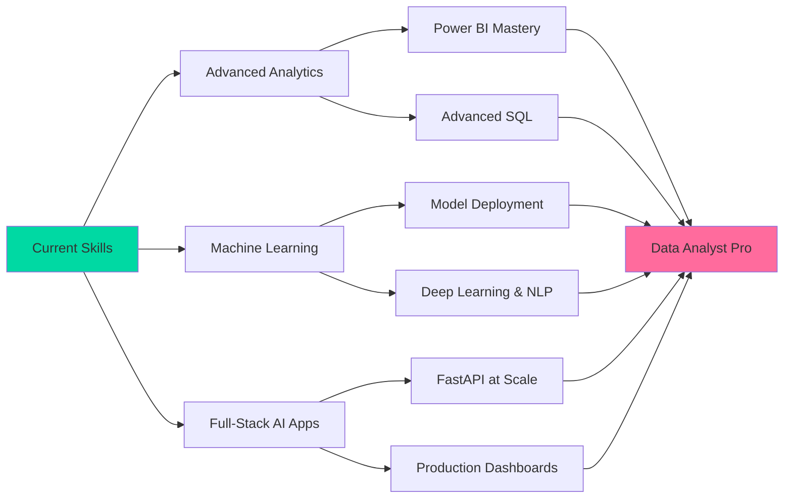

<div align="center">
  
</div>

<p align="center">
  <strong>📊 Data Analyst Intern | AI/ML Developer</strong><br>
  💡 Python • SQL • Machine Learning • Computer Vision<br>
  🚀 Building Dashboards & Full-Stack Apps<br>
  🏆 Smart India Hackathon 2025 National Finalist
</p>

<p align="center">
  <a href="https://www.linkedin.com/in/arpita-sharma-9a1a381b7/">
    
  </a>
  <a href="mailto:arpitaengineer08@gmail.com">
    
  </a>
  <a href="https://github.com/arpitaengineer08-source">
    
  </a>
  <a href="https://leetcode.com/u/arpitasharma02/">
    
  </a>
  <a href="https://www.hackerrank.com/profile/arpitaengineer08">
    
  </a>
</p>

<p align="center">
  
</p>

---

## 💫 ABOUT ME

<table>
<tr>
<td width="50%" valign="top">

### 🎯 CURRENT MISSION

```python
arpita = {
    "name": "Arpita Sharma",
    "title": "Data Analyst Intern & AI/ML Developer",
    "education": "B.Tech CSE (Data Science & AI), SRM University",
    "location": "Shimla, Himachal Pradesh 🇮🇳",
    "working_on": [
        "Data analytics & reporting @ Labmentix",
        "End-to-end ML + BI dashboards",
        "Computer vision & NLP projects",
        "Full-stack AI-powered applications"
    ],
    "currently_exploring": {
        "data_analytics": ["EDA", "Power BI", "SQL optimisation"],
        "machine_learning": [
            "Deep Learning", "NLP", "Predictive modelling"
        ],
        "full_stack": ["FastAPI", "Streamlit", "Flask"]
    }
}

print("Turning raw data into decisions 📊")
```

</td>
<td width="50%" valign="top">

### 💭 PHILOSOPHY & APPROACH

> **"I don't just want a chart that looks good—**
>
> **I want it to answer the question someone actually asked."**

**My Approach:**

- 🔍 **Clean First** → Messy data → Trustworthy data
- 🧩 **Find the Signal** → Numbers → Insight
- ⚡ **Build & Ship** → Analysis → Working dashboard
- 🎯 **Keep Improving** → Good → Production-ready
- 📚 **Explain Simply** → Technical → Understandable

**Impact Over Buzzwords**

Dashboards and models that answer real questions, not just look impressive.

</td>
</tr>
</table>

---

## 🔭 WHAT I'M UP TO

<table>
<tr>
<td width="33%" valign="top">

### 🔭 CURRENTLY BUILDING

- 📊 Data analytics @ Labmentix
- 🧠 NeuroEase: AI mental health platform
- 🎬 MovieIQ Studio: ML + BI dashboard
- 🏏 Cricbuzz LiveStats: live API analytics

</td>
<td width="33%" valign="top">

### 🌱 CURRENTLY LEARNING

- 📈 Advanced Power BI & dashboards
- 🤖 Machine Learning & Deep Learning
- 💬 NLP & Document AI
- ⚡ FastAPI & SQL optimisation

</td>
<td width="33%" valign="top">

### 🤝 OPEN TO

- 📊 Data Analyst internships
- 🤖 ML / AI internships
- 🌐 Open-source & research collaboration
- 💡 Hackathons & team projects

</td>
</tr>
</table>

| | |
|:---|:---|
| 👯 **Looking to collaborate on** | Computer vision, NLP / document AI, ML research projects and hackathon teams |
| 🤝 **Looking for help with** | Publishing my research paper, deploying ML models, and improving model accuracy in low-light conditions |
| 💬 **Ask me about** | Python, OpenCV, MediaPipe, Flask, computer vision, PDF chat assistants, hardware prototyping |
| ⚡ **Fun fact** | I built a piano playable in mid-air with hand gestures 🎹 and speak English, Hindi and French 🇫🇷 |

---

## 🚀 FEATURED PROJECTS

| 🧩 Project | 📝 What it does | 🧰 Tech |
|:---|:---|:---|
| 🧠 **NeuroEase** | AI-powered mental health platform | Python, ML |
| 🎬 **MovieIQ Studio** | ML + BI dashboard for movie insights | Python, Pandas, Streamlit |
| 🏏 **Cricbuzz LiveStats** | Live cricket analytics using APIs and SQL | Python, SQL, APIs |
| 😊 **Emotion-Based Music Player** | Detects facial emotions and plays matching music | Python, OpenCV, Deep Learning |
| 🎹 **Hand Gesture Piano** | Virtual piano controlled by hand landmarks | Python, OpenCV, MediaPipe |
| 📄 **AI Chat Assistant for PDFs** | Context-grounded question answering from PDFs | Python, NLP, Flask |
| 🛒 **Amazon Clone** | Full-stack e-commerce app with authentication | Flask, SQLite |

---

## 🛠️ TECH STACK

### 📊 DATA & ANALYTICS

<p>
  
  
  
  
  
</p>


### 🤖 AI / ML


### ⚡ BACKEND & APPS

<p>
  
  
  
  
  
</p>

### 🎨 FRONTEND & LANGUAGES

<p>
  
  
  
  
  
</p>

### 🛠️ TOOLS

<p>
  
  
  
  
</p>

---

## 🎯 EXPERTISE MATRIX

| 🎯 Domain | 🔥 Key Skills |
|:---|:---|
| **Data Analytics** | Python, Pandas, NumPy, SQL, Power BI, Excel |
| **Machine Learning** | Predictive modelling, scikit-learn, PyTorch, BI |
| **Computer Vision & NLP** | OpenCV, MediaPipe, Document AI, real-time tracking |
| **Backend Development** | FastAPI, Flask, SQLite, REST APIs |
| **Dashboards** | Streamlit, Jupyter Notebook |
| **Mobile Development** | Flutter, Firebase |
| **Core CS** | Data Structures, DBMS, C++ |

---

## 🎓 LEARNING ROADMAP



---

## 🏆 ACHIEVEMENTS & LEADERSHIP

### 🥇 Smart India Hackathon 2025 — National Finalist

Represented **Team Vajraa** at GIET University, Gunupur, in a national-level hardware competition. Built and debugged a sensor-based prototype within 36 hours, demonstrating strong execution and innovative problem-solving.

### 🎤 Coordinator — AI Lytics, Coding Society

SRM University · September 2025 – Present

Organising university-wide AI workshops, hackathons and seminars.

---

## 📊 GITHUB STATS

<p align="center">
  
  
</p>

<p align="center">
  
</p>

<p align="center">
  🏆 <a href="https://github.com/arpitaengineer08-source">View my GitHub profile and achievements</a>
</p>

---

## 💭 PHILOSOPHY

<div align="center">

### "Good data analysis isn't about the fanciest model—
### it's about an answer someone can actually act on."

**🎯 Core Principles**

💎 **Clarity Over Complexity** · Simple, correct answers beat clever ones

🔍 **Curiosity Driven** · Always ask what the data is really saying

🚀 **Build to Ship** · Create dashboards and apps people can actually use

🤝 **Collaborate Actively** · The best insights come from asking the team

</div>

---

## 🤝 LET'S CONNECT

<p align="center">
  <a href="https://www.linkedin.com/in/arpita-sharma-9a1a381b7/">
    
  </a>
  <a href="mailto:arpitaengineer08@gmail.com">
    
  </a>
  <a href="https://github.com/arpitaengineer08-source">
    
  </a>
</p>

<p align="center">
  ⭐ Star my repositories if you find them helpful!
</p>

<div align="center">
  
</div>

<p align="center">
  <sub>Made with 💜 by Arpita Sharma · Powered by curiosity, coffee, and clean data ☕✨</sub>
</p>
